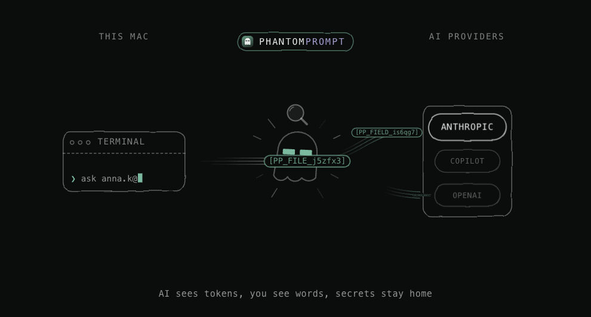
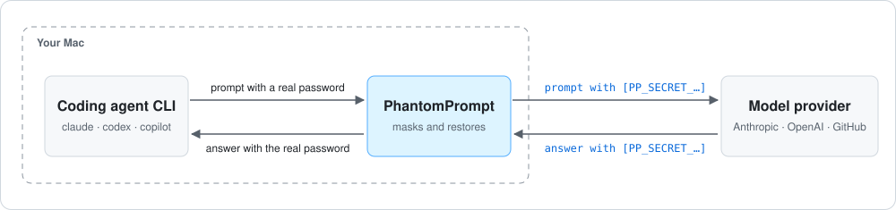

<div align="center">


# PhantomPrompt

### Keep secrets and personal data out of your coding agent's prompts.

**The model sees placeholders. You get the real values back.**

<!-- version:start -->
[](https://github.com/bababytes/phantomprompt/releases/latest)
[](https://github.com/bababytes/phantomprompt/actions/workflows/ci.yml)
[](#install)
[](#development)
[](LICENSE)
<!-- version:end -->

**[Download for macOS](https://github.com/bababytes/phantomprompt/releases/latest)**

[Quick start](#quick-start) · [How it works](#how-it-works) · [Supported agents](#supported-agents) · [Trusted folders](#trusted-folders) · [FAQ](#faq) · [Development](#development) · [Contact](#say-hi-)



<code>phantom claude</code>

<br />

</div>

---

PhantomPrompt replaces sensitive values (VINs, e-mail addresses, GUIDs, labelled fields, secrets, your own patterns) with placeholders before AI coding agents send them to a model, and puts the real values back into the answer.

It runs on your Mac and masks values before they leave it. The token map lives in memory only and is never written to disk. It works with Claude Code, Codex CLI and GitHub Copilot CLI.

> **macOS only.** The app, the panel and protected terminals need macOS. On Linux the engine and CLI compile, but there is no app and no support.

## Who it's for

Developers who let an AI coding agent work in the terminal, where it reads more than you see:

- **Large codebases.** The agent opens files on its own: configs, fixtures, SQL dumps, `.env` files. Nobody checks each file before it goes into the prompt.
- **Logs and data nobody has checked.** Application logs, stack traces, `kubectl logs` or API responses often carry e-mails, VINs, tokens or customer IDs. Asking the agent to analyse them sends all of it to the model.
- **Pasted output.** A quick copy from a terminal or a ticket can hold a password you did not notice.

PhantomPrompt masks the formats it knows before any of this leaves your Mac. It is a safety net, not a guarantee: names or addresses in free prose are not detected (see [Threat model](#threat-model)). Add your own pattern in the panel for values specific to your project.

## Quick start

### Install

1. Download `PhantomPrompt-<version>.dmg` from [Releases](https://github.com/bababytes/phantomprompt/releases/latest), open it and drag **PhantomPrompt** to **Applications**.
2. Let macOS run it. PhantomPrompt is not notarized by Apple yet, so macOS blocks it on first start. This command removes the "downloaded from the internet" mark from this one app:

   ```sh
   xattr -dr com.apple.quarantine /Applications/PhantomPrompt.app
   ```

3. Add the `phantom` command, then open a new terminal window:

   ```sh
   echo 'alias phantom=/Applications/PhantomPrompt.app/Contents/MacOS/phantomprompt' >> ~/.zshrc
   ```

Every release is built from this repository by GitHub Actions.

<details>
<summary>Check the download (optional)</summary>

Download `SHA256SUMS` from the same release into the folder with the DMG and run there:

```sh
shasum -a 256 -c SHA256SUMS --ignore-missing
```

Each downloaded file should print `OK`. Command-line builds without the app are in `PhantomPrompt-macos-arm64.zip` (Apple silicon) and `PhantomPrompt-macos-amd64.zip` (Intel).

</details>

### Protect your terminal

```sh
phantom
```

This opens a protected shell: `claude`, `codex`, `copilot` and other tools you start in it go through PhantomPrompt. Type `exit` to leave. To protect a single command, put `phantom` in front of it:

```sh
phantom claude
```

### Commands

| Command | What it does |
|---|---|
| `phantom` | Opens a protected shell. Type `exit` to leave. |
| `phantom claude`, `phantom codex`, `phantom copilot …` | Runs one command under protection. |
| `phantom open` | Starts the app in the background (if needed) and opens the panel. |
| `phantom stop` | Stops the app. |
| `phantom trust [folder]`, `phantom untrust <folder>` | Lists, adds or removes [trusted folders](#trusted-folders). |
| `phantom version` | Prints the version. |

The app starts on first use and keeps running after the terminal closes. The panel opens through a one-time link, so open it with `phantom open` or the app icon rather than a bookmark. The browser tab keeps its sign-in until it is closed or PhantomPrompt restarts; no cookie is set, so a new tab needs a new link.

### Update PhantomPrompt

Check which version you run:

```sh
phantom version
```

To update, stop the app, replace it with the new release and start it again:

1. `phantom stop`
2. Download the new release and install it as in [Install](#install), replacing `/Applications/PhantomPrompt.app`.
3. `phantom open`
4. In every protected terminal, type `exit` and run `phantom` again. Running sessions keep what they have learned until they end.

## How it works



A protected terminal sends the agent's traffic to PhantomPrompt. Before a prompt leaves your Mac, PhantomPrompt replaces every sensitive value with a placeholder and remembers the pair in memory. When the answer comes back, it puts the real values back in place.

## Supported agents

| Agent | Route |
|---|---|
| Claude Code | Local gateway (`ANTHROPIC_BASE_URL` points at it), with its own token map per terminal. |
| Codex CLI | Local gateway for the built-in ChatGPT and OpenAI providers. A custom model provider is kept and runs behind the HTTPS proxy. |
| GitHub Copilot CLI | HTTPS proxy that inspects the Copilot API. |

## Trusted folders

Test fixtures full of fake e-mails, VINs and passwords do not need masking. `phantom trust src/test` makes every value found in that folder public; `phantom untrust src/test` masks them again, and `phantom trust` lists the folders. In the panel, the **Protected terminals** card does the same: **Trust a folder…** next to a terminal opens a folder picker in that terminal's folder, and the trusted folders are listed below the table with **×** to mask them again.

- The app scans the folder with the same detectors it masks with and keeps the list of values it found. Those values are never masked, however they reach the model: a file read, `cat`, `sed` or `grep` output, pasted text, or the model quoting them back. This works the same for every agent.
- A value found in the folder also passes outside it, for example the same e-mail in another file. Keep real data out of trusted folders: it reaches the model unmasked.
- Values in a protected or blocked folder that you set inside a trusted one are not scanned and stay protected.
- Changed files are scanned again within a minute, and every file when you change the rules. Files over 8 MB and binary files are skipped; a folder over 50,000 files or 256 MB is reported as too large and stays masked (`phantom trust` and the panel show it).

## FAQ

<details>
<summary><strong>Does PhantomPrompt send my data anywhere?</strong></summary>

No. It has no server of its own and listens on loopback only. Your prompts go, masked, to the AI service your agent already uses, and other traffic from a protected terminal passes through unchanged. The token map stays in memory. See [what is stored on disk](#what-is-stored-on-disk).

</details>

<details>
<summary><strong>Do I have to start my agent with <code>phantom</code>?</strong></summary>

Yes. Only tools started in a protected shell (`phantom`) or with `phantom <command>` are protected. An agent started in a normal terminal talks to its AI service directly.

</details>

<details>
<summary><strong>Does it protect chats in the browser?</strong></summary>

No. PhantomPrompt protects the [supported agents](#supported-agents) in a protected terminal. A browser you open the usual way does not go through it.

</details>

<details>
<summary><strong>Why did a value reach the model unmasked?</strong></summary>

Either it was found in a [trusted folder](#trusted-folders), or its format is not detected. Masking is heuristic: it catches the formats listed in the [threat model](#threat-model) and labelled fields (`firstName: …`, `"email": …`); names or addresses in free prose are not detected. Add your own pattern in the panel for values it misses.

</details>

<details>
<summary><strong>What should I do if I hit a bug?</strong></summary>

[Update](#update-phantomprompt) first; a newer release may already fix it. If the problem persists, [open an issue](https://github.com/bababytes/phantomprompt/issues) with the output of `phantom version`, the agent you used, the steps to reproduce and the error. The app log in `~/Library/Logs/PhantomPrompt/` contains no prompt text or values and helps with most reports.

</details>

## Privacy and security

### What is stored on disk

The token map is never written to disk. These files are (all `0600`, in your user account):

| File | Contents |
|---|---|
| `~/Library/Application Support/PhantomPrompt/rules.json` | Enabled detectors, your field names, your regular expressions, protected and trusted folders. Your patterns may contain the words they protect. |
| `~/Library/Application Support/PhantomPrompt/engine.sock` | Local socket the CLI uses to talk to the app. |
| `~/Library/Application Support/PhantomPrompt/gateway.key` | App Store edition only: the fixed gateway key for your shell profile. |
| `~/Library/Logs/PhantomPrompt/YYYY-MM-DD.log` | App log, one readable line per important entry: errors, blocked requests, errors returned by the AI service, placeholders not restored, protection turned off or on, app start and stop, crash traces. No prompt text, values, placeholders, credentials, login links or session IDs. One file per day, the newest 7 are kept, at most 5 MB a day; Clear history in the panel does not delete it. |
| `$TMPDIR/phantomprompt-ca-*.pem`, `phantomprompt-shims-*/`, `phantomprompt-terminal-*/` | Public certificate of the local CA, command wrappers of the protected shell, a self-deleting launcher. Removed on exit. |

### Threat model

- The boundary is your user account. Processes running as you can reach the socket, the panel and the app's memory; other users of the Mac and the network cannot (all listeners are loopback only).
- Memory is not zeroed: a dump of the app's process contains the token map.
- Masking is heuristic. It catches the formats listed above and labelled fields (`firstName: …`, `"email": …`); names or addresses in free prose are not detected.
- Passwords are masked when they have a known format (AWS, GitHub, Slack, Google, Stripe, OpenAI/Anthropic keys, JWTs, private key blocks), sit in a URL (`postgres://user:<password>@host`) or follow a label (`DB_PASSWORD=…`, `db.password.mongo=…`, `password: "…"`, `PASSWORD '…'` in SQL). A bare value after a label counts only where config files put it (its own line, a `--flag`, a connection string); in code the value must be a quoted string. Short or simple label passwords (`postgres`, `admin`) are masked where they stand but not wherever the same word appears. The label detector can be switched off in the panel.
- Secrets stay masked in shell, web and MCP tool calls; only file edits get the real value back.

### Limits

- 128 model requests at once across the app. A streamed answer holds its slot until it ends; request 129 waits up to 10 s, then gets `503` with `X-Should-Retry: true`.
- 128 protected terminals or agent sessions at once.
- A protected or blocked folder must be indexed whole: up to 2,000 files, 16 MB in total and 1 MB per text file (binary files are skipped). A folder over a limit, with an unreadable file, or missing stops every protected request with `protected_folder_not_indexed` until you narrow, fix or remove it; the panel shows the reason.
- The Codex gateway passes only model requests (`/responses`) and the model list; other OpenAI routes are refused.
- After an update, restart protected terminals: running sessions keep what they have learned until they end.

## Development

Build from source with the Go version from `go.mod`. Node ≥ 20 is needed only to rebuild the panel, whose built files are committed.

```sh
go build -o bin/phantomprompt ./cmd/phantomprompt
go vet ./...
go test -race ./...
npm ci && npm run build:web   # rebuilds internal/demo/dist after changes in web/
npm run update:macos          # builds the app, installs it in /Applications and starts it
```

CI (`.github/workflows/ci.yml`) runs `gofmt`, `go vet`, the tests with the race detector, a macOS build, `govulncheck`, `npm audit`, and checks that the committed panel matches its sources.

### Releases

Versions follow [Semantic Versioning](https://semver.org/spec/v2.0.0.html); changes are listed in [CHANGELOG.md](CHANGELOG.md). `phantom version` prints the release tag in a release build and a version derived from the last commit in a local build.

1. Describe the changes under `## [Unreleased]` in `CHANGELOG.md` and commit them.
2. Prepare the release. This sets the version in the badge at the top of this README, `package.json` and `CHANGELOG.md`, and prints the next commands:

   ```sh
   zsh scripts/release.sh X.Y.Z
   ```

3. Review the diff, then commit, tag and push:

   ```sh
   git commit -am "Release vX.Y.Z"
   git tag -a vX.Y.Z -m "PhantomPrompt vX.Y.Z"
   git push origin <branch> vX.Y.Z
   ```

Pushing the tag runs `.github/workflows/release.yml`. It checks with `scripts/check-version.sh` that the tag matches the README badge, `package.json` and `CHANGELOG.md`, and that the README links point at the repository the tag was pushed to. Then it runs the tests, builds the DMG and ZIPs with `scripts/package-macos.sh` and publishes a GitHub release with the `CHANGELOG.md` entry as its notes.

The release is signed with a Developer ID and notarized when the repository has the secrets `MACOS_CERTIFICATE_P12`, `MACOS_CERTIFICATE_PASSWORD`, `MACOS_SIGN_IDENTITY`, `APPLE_ID`, `APPLE_TEAM_ID` and `APPLE_APP_PASSWORD`. Without them the app is signed ad hoc and macOS blocks it on other Macs until the quarantine flag is removed.

## Contributing

[Open an issue](https://github.com/bababytes/phantomprompt/issues) to report a bug or suggest a feature, or [send a pull request](https://github.com/bababytes/phantomprompt/pulls) to improve the code or docs. Run the checks from [Development](#development) before you send it.

## Say hi 👋

Want to run PhantomPrompt at your company, need a hand setting it up, or just have an idea to talk through? Drop me a line at **baba.bytes.dev [at] gmail [dot] com**. I read everything.

Found a bug? An [issue](https://github.com/bababytes/phantomprompt/issues) is the fastest way to get it fixed.

## License

PhantomPrompt is open source under the [Apache License 2.0](LICENSE). Copyright 2026 BaBa.

You may use, change and share it, also commercially. If you redistribute PhantomPrompt or build on it, keep the [LICENSE](LICENSE) and [NOTICE](NOTICE) files so the credit to BaBa stays with it.

PhantomPrompt is not affiliated with or endorsed by Anthropic, OpenAI or GitHub. Product names are trademarks of their owners.
